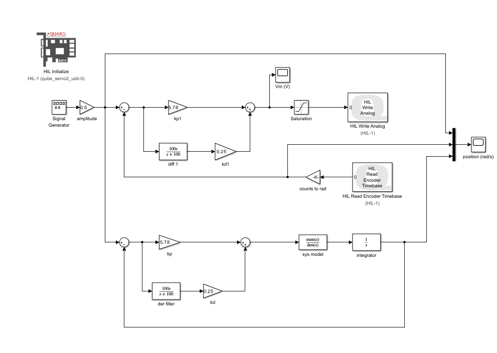
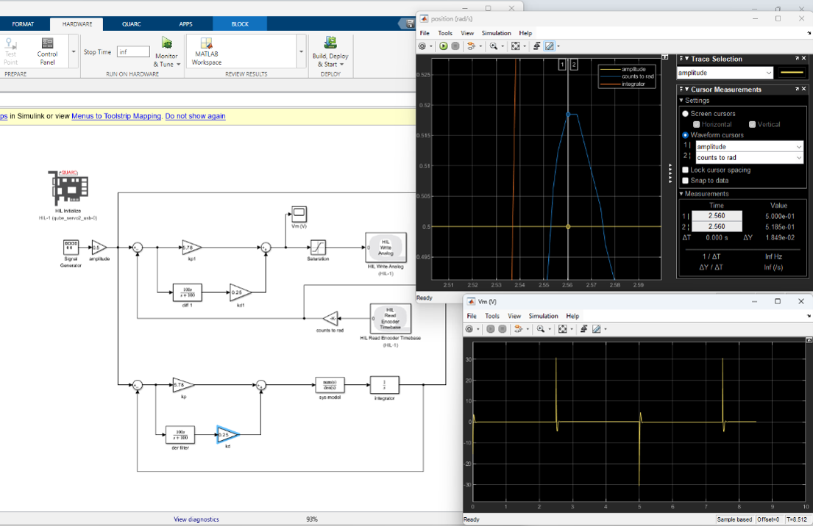
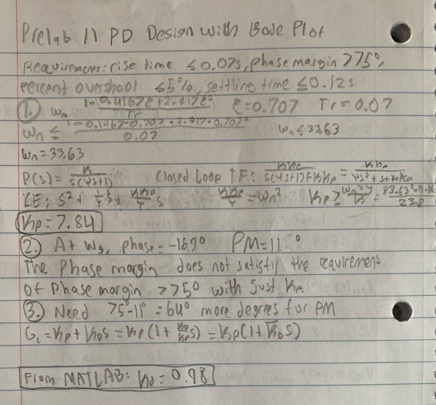
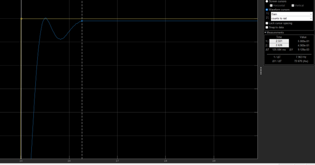

# Real Time Servo Control & Hardware in the Loop Tuning

## Overview
This repository contains my control systems lab work for modeling, analyzing, and tuning closed loop feedback systems using a Quanser QUBE Servo 2 DC motor system. The project covers time domain controller design using Root Locus, frequency domain tuning using Bode plots, PID steady state error analysis, and real time Hardware in the Loop execution via MATLAB, Simulink, and QUARC.

---

## Technical Stack & Hardware
* **Hardware:** Quanser QUBE Servo 2 Direct Drive DC Motor with Optical Encoder
* **Software:** MATLAB R2023b+, Simulink, QUARC Real Time Control Software Target
* **Core Concepts:** Root Locus Design, Bode Plots, Damping Ratio (ζ), Natural Frequency (ω_n), Phase Margin, PID Control, Steady State Error

---

## 1. Time Domain PD Control Design via Root Locus (Position Control)

### Objective & Constraints
Design a Proportional Derivative (PD) controller to control motor position while meeting design specifications:
* **Percent Overshoot:** ≤ 5%
* **Peak Time (t_p):** ≤ 0.15 s

### Procedure & Hardware Validation
1. **System Modeling:** Modeled the open loop DC motor transfer function G_p(s) = 24 / [s(0.165s + 1)]. Hand calculated a proportional gain K_p = 5.78 for a target damping ratio ζ = 0.7.
2. **Root Locus Analysis:** Used MATLAB's rlocus function to evaluate derivative gain (K_d) selection.
3. **Hardware Tuning:** Due to physical motor friction and sensor discretization, gains were tuned on hardware to K_p = 5.78 and K_d = 0.25.
4. **Results:** Achieved 3.76% Overshoot and a 0.06 s Peak Time on the physical hardware.

| Simulink HIL Model Diagram | Tuned Hardware Scope Output |
| :---: | :---: |
|  |  |

---

## 2. Frequency Domain PD Design via Bode Plots

### Objective & Setup
Design a PD controller using frequency response techniques targeting:
* **Phase Margin (PM):** ≥ 75°
* **Rise Time (t_r):** ≤ 0.07 s

### Implementation & Results
* Derived theoretical gain formulas by hand to calculate target phase lead (K_p = 7.84, K_d = 0.98) and generated Bode frequency plots using MATLAB's bode script.
* Applied PD zero compensation to add necessary phase lead (K_p = 10.5, K_d = 0.35).
* **Hardware Measurement:** Recorded t_r = 0.028 s, t_s = 0.126 s, and %OS = 0.62% on the motor system.

| Handwritten Prelab Phase Lead Derivations | Hardware Response Output |
| :---: | :---: |
|  |  |

---

## 3. Steady State Error Reduction & PID Topology Comparison

Evaluated System Type classifications and steady state error (e_ss) under Step (3 rad) and Ramp (15 rad/s) inputs across PD, PI, and PID configurations.

### Theoretical vs. Experimental Results

| Input Type | Controller Type | Theoretical Error | Experimental Error | Notes |
| :---: | :---: | :---: | :---: | :---: |
| **Step (3 rad)** | PD | 0 rad | 0.00567 rad | Fast response, small noise offset |
| **Step (3 rad)** | PID | 0 rad | 0.00660 rad | Integrator eliminates steady state offset |
| **Ramp (15 rad/s)** | PD | 0.875 rad | 0.89100 rad | Significant tracking lag |
| **Ramp (15 rad/s)** | PID | 0 rad | 0.00368 rad | Integral action reduced ramp tracking error to ~0 |

---

## Project Takeaways
* Interfaced MATLAB and Simulink with physical hardware targets in real time using QUARC.
* Verified theoretical s domain calculations and Root Locus designs against real world hardware behavior.
* Observed how physical factors like friction and noise affect gain selection compared to ideal software simulations.
